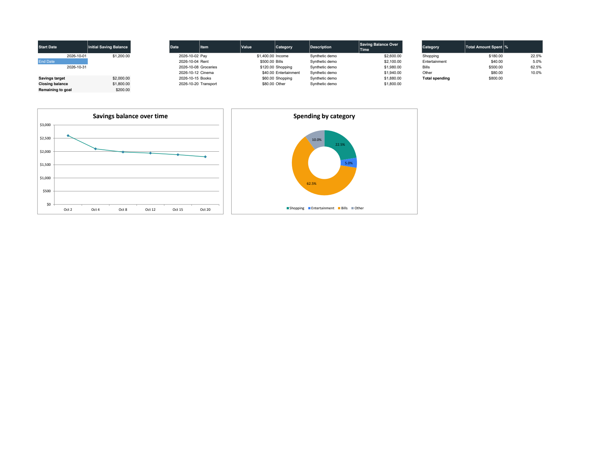
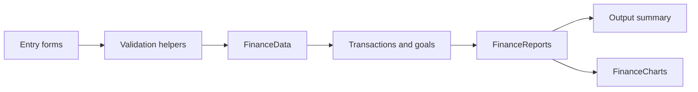

# VBA Financial Planning Support Tool

An Excel application for recording income and expenses, tracking a savings goal, and understanding where money is spent.

[Open the workbook](Cris%20Chen%20-%20Individual%20Milestone%204%20-%20Prototype.xlsm) · [Architecture](docs/ARCHITECTURE.md) · [VBA source](src/README.md) · [Tests](docs/TESTING.md)



*Actual Excel output using synthetic demonstration data: opening balance $1,200 + income $1,400 − expenses $800 = closing balance $1,800. The remaining amount to the $2,000 target is $200. The distributed workbook retains its original input records.*

## What it does

| Workflow | Result |
| --- | --- |
| Record a transaction | Save its date, item, positive amount, category and optional description |
| Set a savings goal | Save a start date, end date, opening balance and target |
| Generate a report | Use the latest goal and include transactions within its inclusive date range |
| Review savings | View a chronological balance trend, closing balance and amount remaining to the target |
| Review spending | Compare Shopping, Entertainment, Bills and Other, with income excluded from spending shares |

The application uses local worksheets for storage and VBA UserForms for data entry. It has no backend service or account connection.

## Try it

1. Download the workbook above and open a local copy in desktop Excel with VBA available. The verified environment is Windows Excel 16.0.
2. On `Goals`, use the existing add-goal control. Enter valid calendar dates, a nonnegative opening balance and a positive target. The latest saved goal becomes active; older goal rows remain available.
3. On `Expenses&Incomes`, use the add-item control. Enter a positive amount and select `Income` for money received, or one of the four expense categories for money spent.
4. On `Output`, use the existing report control to generate the dashboard. Adding a transaction or goal clears the old report until it is generated again.

The original macro entry points remain available through Excel's macro dialog: `ButtonAddSavingGoal_Click`, `Button3_Click` and `Button4_Click`. Clear controls delete the corresponding input records or report contents, so use a working copy when exploring them.

## How it is organized



| Layer | Responsibility |
| --- | --- |
| Forms | Collect inputs, show validation messages and call services |
| `WorkbookSupport` | Resolve this workbook's sheets, find data bounds and parse dates/numbers |
| `FinanceData` | Append validated transactions and goals |
| `FinanceReports` | Select the goal period, calculate balances and expense totals |
| `FinanceCharts` | Create the two named report charts below the populated data |
| `Module1` / `Module2` | Keep existing clear and navigation macro names compatible with workbook buttons |

The [architecture document](docs/ARCHITECTURE.md) describes the worksheet schema and calculation rules.

## Repository

```text
README.md
*.xlsm                  Runnable application and form designers
src/
  modules/              Standard VBA modules
  forms/                UserForm code snapshots
  host/                 Workbook and worksheet code snapshots
  legacy/               Original loose snippets, preserved for provenance
  manifest.json         Workbook and component hashes
docs/                   Architecture, testing and demonstration images
scripts/                Source extraction and native Excel test runner
tests/vba/              Disposable-workbook smoke tests and demo fixture
```

Form snapshots contain code only. Full designer resources stay in the `.xlsm`; see the [source editing contract](src/README.md) before importing or editing components.

## What changed in this revision

- Separated form events, worksheet storage, reporting and chart rendering.
- Added calendar-date, numeric-amount, category and goal-order validation.
- Replaced active-sheet references with explicit references to this workbook.
- Corrected the spending denominator, handled zero spending and applied goal date boundaries.
- Added a goal summary, removed overlapping report charts and made repeated refreshes produce a consistent result.
- Added native Excel regression tests, complete source snapshots and a source synchronization check.

## Verification and current scope

Native Excel tests cover form initialization, date and amount boundaries, balance reconciliation, inclusive goal dates, the latest-goal rule, empty/income-only datasets, old-row cleanup, chart counts and isolation from another active workbook. See [test instructions and results](docs/TESTING.md).

Amounts use VBA `Currency`; the `$` display does not assign a currency code or perform conversion. Transactions are manually entered, and dates outside the active goal are excluded from its report. The tool tracks a balance against a target; it does not predict income or the date a goal will be reached. Original input data is retained, and historical repository snippets are available in `src/legacy/`.
